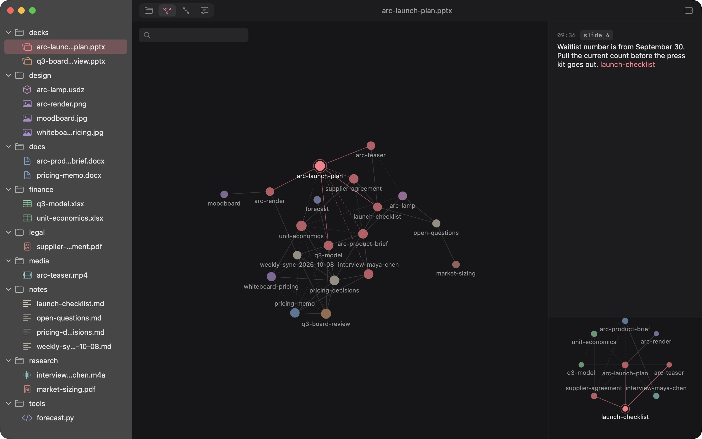

# Flamingo

Flamingo is Obsidian for every file on your Mac. Open a folder and preview anything in it:
decks, documents, spreadsheets, PDFs, 3D models, images, video, code, and markdown. Press a
key to leave a thought on the slide, page, cell or moment you're looking at, and link
thoughts with `[[wikilinks]]`. The graph then shows how your real work connects. Flamingo
also records a trail of what you opened, said and searched, so the chain of thought behind a
decision builds itself without you typing the links. Text and Markdown have a built-in editor;
Office documents open in their native editors. Thoughts and relationships live beside your files.

## Daily work

Open an existing folder and press ⌘K or ⌘F to search filenames, folders, content, and thoughts
in one panel. Cataloged filenames are available before content indexing finishes. Select a
result to inspect its exact match and automatic file-family candidates; Office locations
use labeled extracted source text, while PDFs show the actual page. Drag a result into another
app or use **Copy File**. ⌃⌥F summons search over your current app; type `>` for commands.
⌘⇧F keeps search in the sidebar. See [unified search](docs/UNIFIED-SEARCH-2026-10-16.md)
for filters, family evidence, and preview limits.

The Files sidebar keeps every pinned folder visible. Other folders are quieter and start
with three rows; **Show more** reveals the rest. Right-click a folder to pin or unpin it.
Opening a file through search reveals its folder even when it was outside that preview.

Use **Split View** in the toolbar or **Command-\\** to keep two documents beside each other.
Drag the divider to resize them. Each pane remembers its own file and page, slide, cell, or
text location; click a pane to make it the target for navigation, Save, and capture.
**Command-Option-Right** focuses the other pane. **Open Beside** is also available from
file, bookmark, and working-tab context menus.

The right-hand **Related Files & Thoughts** rail follows the active pane. Its context card
shows document links, links from thoughts, manual connection reasons, and backlinks with
source excerpts. Click a result to open it, or its split icon to open its source beside the
current document. **Command-Option-I** shows or hides the rail.

Inside a folder, press **Command-N** and type a kind of file: an extension (`pptx`, `stl`,
`py`) or a word for it (`ppt`, `word`, `excel`, `3d`, `slides`, `mind map`). Pick from the
list with the arrow keys and Return, then give it a name (empty means Untitled), or type
`plan.pptx` to do both at once. Flamingo creates a real document in the folder on screen
without overwriting an existing file: text opens in its editor, Office, iWork, 3D and other
formats in their own app. Kinds only an app can start, like a Shapr3D design or a Blender
scene, open that app. Save text with ⌘S. Drafts recover after
restart; a conflicting external save offers retry, save a copy, and reload with recovery.

Command-Z reverses workspace actions, including file creation and moves, bookmarks,
thoughts, graph edits, trail corrections, navigation, and text saves. Shift-Command-Z
redoes them. Deleting a file or folder has a strict 10-second undo window; after that,
it remains in macOS Trash but Command-Z cannot restore it. Other actions have no timer.
History lasts for the current vault session. Conflicting external edits are preserved.

Saves in Flamingo and native editors opened here can trigger a local AI audit. It saves a
labeled thought and suggested source links. Toggle this in **Index health**. Ask has explicit
workspace/current-file scope, model setup, persisted conversation, citations, and **Save thought**.
Unattached captures go to **Inbox**, where you can assign them to a file.

In Graph, **+++** selects files to connect; Command-click adds more files. Add a reason and
press Connect. **---** removes your manual links. The inspector distinguishes manual links,
document links, shared activity, and folders. Selected folders remain hollow. Name and resume
sessions in Trail, or split, merge, and exclude misleading activity connections.



## Keys

| Keys | Action |
|---|---|
| ⌘O | Open a folder as a vault |
| ⌘K ⌘F | Unified search with previews and file families; type `>` for commands |
| ⌃⌥F | Search from any app; toggle in Go → Search from Any App |
| ⌘⇧F | Search in the sidebar: every match, grouped by file |
| ⌘↩ | Open the selected search result in its default app |
| ⌘C | Copy the selected file/folder in the explorer or bookmarks; text editors retain normal Copy |
| ⌘N | New file of any kind in the folder on screen: type `3d`, `ppt`, `excel`… |
| ⌘S | Save the built-in text editor |
| ⌘Z ⌘⇧Z | Undo, redo (file deletion expires after 10 seconds) |
| ⌥⌘N ⌘⇧N | New note, new folder, named in place |
| ⌘D | Bookmark the current file |
| ⌃⌘S | Show or hide the left sidebar (the ribbon stays) |
| ⌘⇧C | Leave a thought on the current file |
| ⌃⌥Space | Leave a thought from any app (opt in; needs Accessibility). If ⌃⌥Space switches your input source, it's ⌃⌥⌘Space |
| ⌘1 ⌘2 ⌘3 ⌘4 | Files, Graph, Trail, Ask |
| ⌘\\ | Open or close split view |
| ⌘⌥→ | Focus the other document pane |
| ⌘W ⌘⇧W | Close one tab (or the focused pane in split view), hide the window. Neither quits: only ⌘Q does |
| ⌘⌥I | Show or hide related files and thoughts |
| ⌘[ ⌘] | Back, forward |
| ⌥⌘1 ⌥⌘3 | A folder as icons or as Finder columns, with the open file selected (also the columns button at the top of the ribbon) |
| ⇧⌘D ⇧⌘O ⌥⌘L ⇧⌘H ⇧⌘A | Desktop, Documents, Downloads, Home, Applications (Finder's Go keys) |
| ← → ↑ ↓, Space, ⌘↓, ⌘↑, ⇧⌘. | In columns: walk the columns, Quick Look, open, enclosing folder, hidden files |
| ⌘↑ ⌘↓ | Previous or next page or slide |
| Esc | Dismiss |

## Build and run

Requires macOS 14 or later and Xcode, not just the Command Line Tools. `scripts/env.sh` finds
Xcode-beta or Xcode in `/Applications`; set `DEVELOPER_DIR` to use another. There are no
dependencies to install.

```
make demo      # build, copy the demo vault to a temp folder, open it
make run       # build and launch on your last vault
make test
make release   # build/Flamingo.zip
```

The demo vault in `fixtures/vault/` belongs to a small studio launching a desk lamp. It
holds real decks, documents, sheets, PDFs, images, a video, an interview recording, a 3D
model, notes, comments, and two days of trail. `make demo` always opens a fresh copy.

## Where state lives

Project metadata lives in `<vault>/.flamingo/`. Most of it is readable text; the search index is SQLite:

```
.flamingo/
  notes/decks/q3-board-review.pptx.md   thoughts on that file, one per line
  trail.jsonl                           what you opened, said and searched
  trail-names.json                      names you gave your thought chains
  trail-corrections.json                split, merge and inference choices
  connections.json                     explicit graph connections and reasons
  path-aliases.json                     old paths kept usable after renames
  bookmarks.json                        sidebar bookmarks, in Obsidian's format
  index.sqlite                          full-text index (rebuildable)
  graph.json                            links and trail edges (rebuildable)
  graph-layout.json                     where you left the graph's nodes
```

A thought looks like this:

```
- [2026-10-13 14:11] (slide 7) Pricing contradicts [[q3-model.xlsx]]. The model still carries Arc at $229.
```

Flamingo writes file contents when you save in its text editor. Indexing and analysis read
content and may add the extended attribute `com.flamingo.id`, which lets thoughts follow
identity-confirmed renames. Text saves preserve that identity and the original permissions
and metadata. Working tabs, locations and history are stored per vault in app preferences.
Text recovery copies live in `~/Library/Application Support/Flamingo/Drafts`, independently
of the source volume. Capture and comment-edit recovery stays in the vault's `.flamingo/`.

**Index health** shows complete, partial, failed, and name-only coverage, storage, pause/rescan,
and retry controls. Large or unavailable cloud files remain discoverable by name. Some formats
cannot expose exact internal locations; Flamingo reports that and offers the native editor.
The app bundle is a local development build; notarized distribution is a separate release step.

## Obsidian

Sidecars are ordinary markdown. Open a vault's `.flamingo/notes/` folder in Obsidian and
every file's thoughts are a note there. A link that names a file with its extension, such as
`[[q3-model.xlsx]]`, opens the notes on that file. Inside Flamingo, links resolve the way
Obsidian's do: by path, then by file name, then by file name without its extension.
